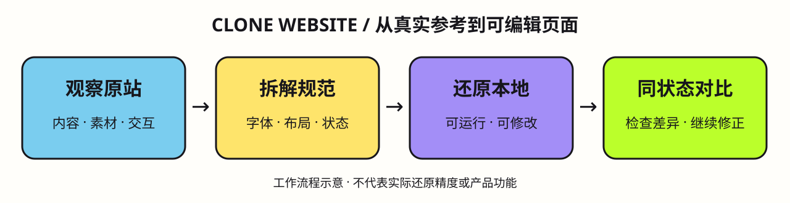

# Clone Website｜从参考网站到可编辑代码

先观察真实网站，再拆解内容、素材、排版与交互，最后还原成可运行、可修改的本地页面。适合网页复刻、界面研究，以及在已有页面基线上讨论新功能。



上图是工作流程说明，不是实际网站的还原成果或精度证明。

## 能做什么

- 拆解真实字体、配色、布局、图片、SVG 与视频素材。
- 区分滚动、点击、悬停和时间驱动的交互，覆盖桌面与手机状态。
- 保留已有项目路由和资源，交付可编辑代码，而非截图或 iframe 冒充实现。
- 按相同视口、滚动位置与交互状态对比，先修复主要差异。
- 针对 Framer、固定滚动场景和动效提供专项检查。

## 使用示例

```text
使用 $clone-website，还原我提供的网站页面。先观察桌面和手机布局、真实素材与主要交互，整理拆解结果，再做可运行的本地页面。先匹配参考，再加入我的需求；完成后提供对照截图和仍有差异的地方。
```

将整个 `clone-website/` 目录放到所用 Agent 的技能目录，保留 `references/`，入口见 [SKILL.md](SKILL.md)。运行环境需提供浏览器、文件操作和对应项目的开发能力；本包不包含账号、浏览器会话或认证信息。

## 随包内容

- [检查与素材提取](references/inspection-guide.md)
- [Framer 与动画观察](references/framer-and-motion.md)

使用自己有权访问和使用的内容与素材；“像素级”是对照与修正目标，不代表未经验证即可承诺完全一致。本次仅发布技能包，未执行网站克隆任务。
