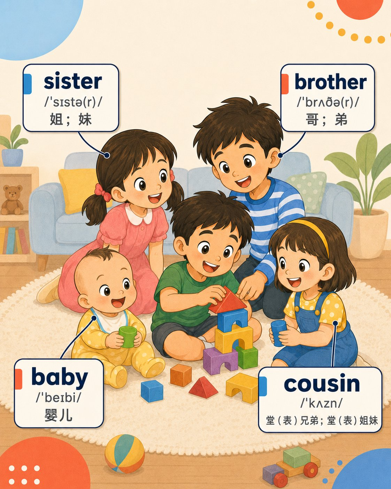
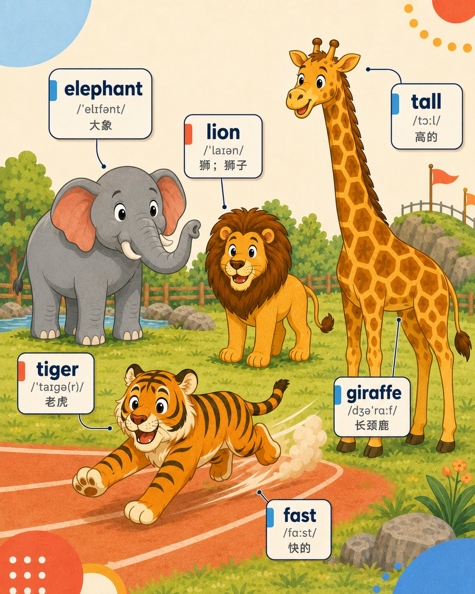
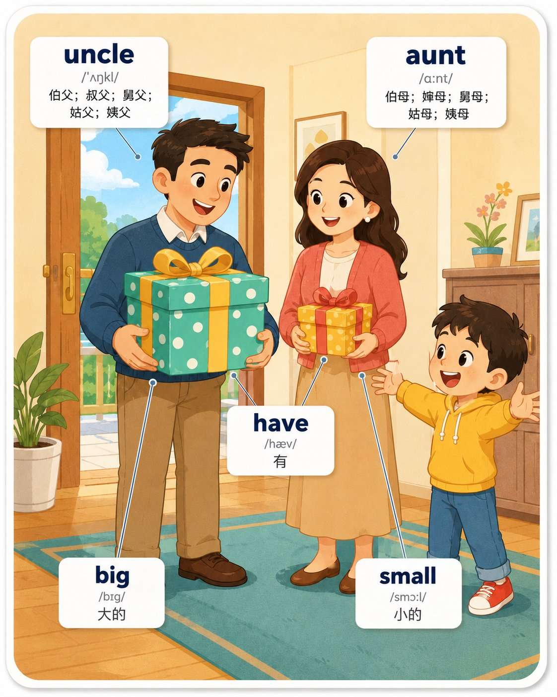
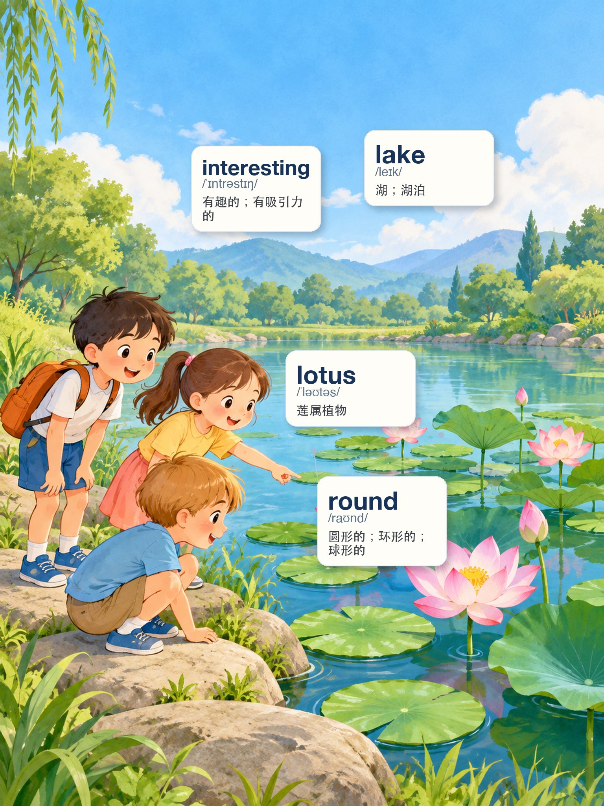
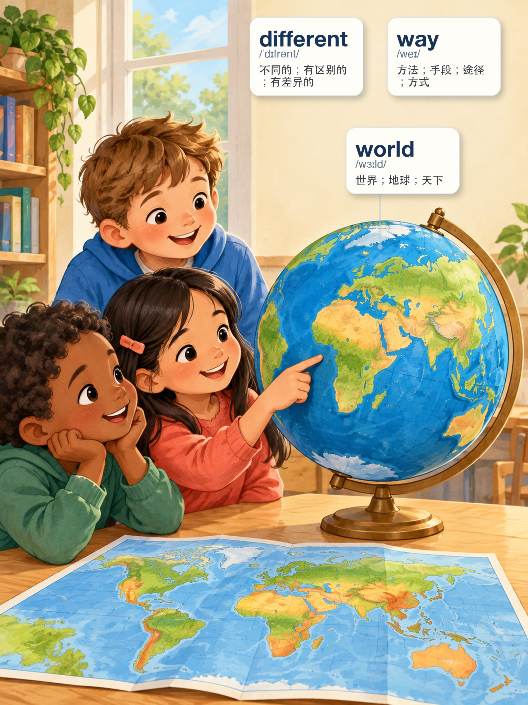
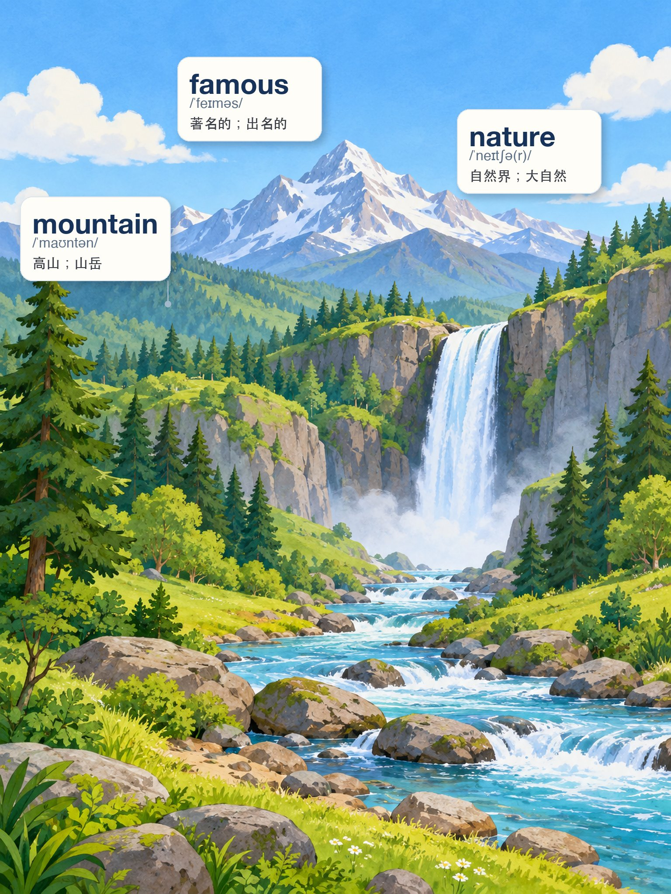

# Demo Gallery｜场景闪卡成品示例

> 先看成品，再了解这套 Skill 是怎么工作的。

这里展示的是 **English Scene Flashcards** 已经完成的场景闪卡示例。每一张卡都尝试把教材里的词汇放进一个孩子能看懂的真实场景中，让单词、图片、动作和关系一起帮助理解，而不是把单词孤立地排成一张词表。

目前 Gallery 收录：

- **三年级上册 Grade 3**：5 张
- **五年级上册 Grade 5**：5 张
- 共 **10 张场景闪卡示例**

这些案例覆盖了宠物、校园、家庭、动物、植物、自然、世界认知和旅行等不同场景，也展示了名词、动作词、形容词、关系词等不同词类如何进入画面。

---

## Grade 3｜三年级上册

三年级示例更强调 **“看得见、指得出、容易建立第一层词义联系”**。场景主体明确，词汇以常见人物、动物、地点和生活环境为主。

### 01 · Pets｜宠物


**场景词汇**：`dog · like · pet · bird · cat · fish · rabbit`

孩子可以在同一个“和宠物相处”的场景里认识不同动物，同时理解 `pet` 与具体动物之间的关系，也让 `like` 不再只是一个孤立的动词。

---

### 02 · School Garden｜校园花园


**场景词汇**：`school · tree · garden · flower · plant · grass`

通过校园花园，把地点、植物和自然环境放进同一个画面。学生既能看到单个目标，也能建立 `school → garden → plant / flower / grass` 的场景联系。

---

### 03 · Family｜家庭成员



**场景词汇**：`sister · brother · baby · cousin`

家庭成员类词汇如果只看中文翻译很容易混淆。放进真实家庭活动后，人物关系更直观，也更适合口语描述和后续句型练习。

---

### 04 · Animals｜动物与特征



**场景词汇**：`elephant · lion · tiger · giraffe · tall · fast`

这张卡不仅展示动物名称，还把 `tall`、`fast` 这样的特征词融入动物表现中，让形容词通过视觉比较和动作获得意义。

---

### 05 · Family Gifts｜家庭人物与大小对比



**场景词汇**：`uncle · aunt · have · big · small`

人物、物品和大小关系组合在一个送礼场景里。`big / small` 通过真实对比理解，`have` 也通过人物与礼物之间的关系被表达出来。

---

## Grade 5｜五年级上册

五年级示例开始增加 **动作、属性、关系和场景状态**。重点不再只是“这个东西叫什么”，而是让学生从画面中理解词语之间更复杂的关系。

### 20 · Plant Parts｜植物结构与动作


**场景词汇**：`stem · pull · seed · root`

通过孩子拔出植物的动作，同时展示茎、根、种子等植物结构。动作词 `pull` 和植物结构词发生在同一事件中，更容易形成记忆链。

---

### 21 · Lake & Lotus｜湖泊与莲属植物



**场景词汇**：`interesting · lake · lotus · round`

这里既有直接可指认的 `lake / lotus`，也有需要通过整体场景理解的 `interesting`，以及通过荷叶形态表现的 `round`。不同类型的词不再强行用同一种标注方式表达。

---

### 22 · World｜世界与差异



**场景词汇**：`different · way · world`

利用地球仪与地图建立“世界”的视觉中心，再通过观察、比较和路径概念承载 `different`、`way` 这样的抽象词。这类词更依赖整个场景，而不是简单拉一根线指向某个物体。

---

### 23 · Nature｜自然景观



**场景词汇**：`famous · nature · mountain`

通过完整自然风景表现 `nature`，以山体作为 `mountain` 的直接视觉目标；`famous` 则依靠整个“著名自然景观”的语境来理解。

---

### 24 · Hiking Trip｜徒步旅行


**场景词汇**：`before · hotel · go hiking · bring · trip`

把旅行准备、住宿地点、携带装备和徒步活动放进同一个故事场景。这里展示的是另一类闪卡：不是单纯“物体集合”，而是围绕一个任务或事件组织词汇。

---

## 为什么要做成“场景闪卡”？

传统单词卡通常是：

```text
word → 中文
```

English Scene Flashcards 更希望做到：

```text
word → 画面中的对象 / 动作 / 关系 / 状态 → 场景理解
```

这样，学生看到的不只是一个英文单词和一个中文释义，而是这个词 **在什么场景出现、和什么对象有关、表达什么动作或关系**。

一张好的场景闪卡应该让学生做到：

- 第一眼能找到主要学习目标；
- 单词、IPA 和中文清楚可读；
- 图片本身能够帮助解释词义；
- 标签和连接线不会压过插画主体；
- 不同类型的词使用适合自己的视觉表达方式；
- 同一张卡里的词真正属于同一个自然场景。

---

## 这些 Demo 可以怎么用？

如果你是 **老师或家长**，可以把它们当作场景词汇教学、看图说词、口语提问和复习素材的示例。

如果你是 **教辅或 AI 教育内容创作者**，可以通过这些案例了解如何把一组教材词汇组织成一个自然场景，而不是把所有词机械塞进一张图。

如果你是 **Agent / Skill 使用者**，这些图可以帮助你理解最终成品希望达到的方向；正式生产时仍应按照仓库中的 [`SKILL.md`](../SKILL.md)、Core 规则和当前平台 Adapter 执行。

> `demo/` 是给人浏览的成品展示区；[`assets/golden_set/`](../assets/golden_set/) 是用于生产系统严格对照的基准样张。两者用途不同。

---

## 想自己生成一套？

回到 **[项目首页](../README.md)** 查看项目介绍与 Quick Start，或者直接从 **[`SKILL.md`](../SKILL.md)** 开始。

如果你正在使用 Codex、ChatGPT、豆包工作、千问办公或其他 Agent，可以通过对应 Adapter 使用同一套核心规范，继续扩展新的年级、Unit 和场景类型。
