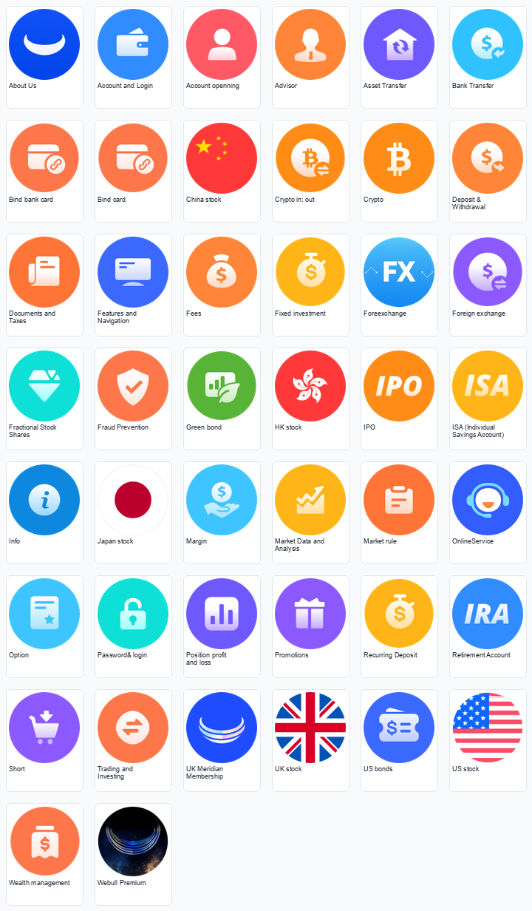

# FAQ 分类图标生成

根据一个分类名称或简短业务说明，制作与现有帮助中心系列一致的图标。适合账户、登录、转账、交易、税务、安全、会员、支持等分类。

## 参考系列



随包包含 44 张原始参考 PNG、合辑与放大图。新资产默认输出 **108×108 透明 PNG**：圆形底色占据主要画布，白色几何符号保持小尺寸可读性。旧图存在多种历史尺寸，不将它们当作新默认值。

## 复用示例：Open API


既有生成结果的原样导出示例，108×108、透明背景；用于展示从分类语义到系列图标的复用，并非本次发布重新生成。

## 使用

```text
使用 $generate-faq-icons，制作“Open API”分类图标：
108×108 透明 PNG，保持现有系列的圆形底色、白色符号和留白。
```

从 [SKILL.md](SKILL.md) 开始，先读 [风格规则](references/icon-style.md)，再按需要参考 [分类与符号清单](references/icon-inventory.md)。默认每个分类一张图；仅在明确要求时输出 SVG。

检查 PNG：

```bash
python3 scripts/audit_png.py your-icon.png
```

需要 Python 与 Pillow。脚本报告尺寸、可见边界、透明留白、覆盖率和主色；常规圆形徽章的覆盖率约为 78%–80%，旗帜、品牌和旧尺寸按已说明的例外检查。

Webull 名称、品牌元素与原始参考图不代表本仓库为官方项目，来源与素材边界见 [NOTICE](../NOTICE.md)。
