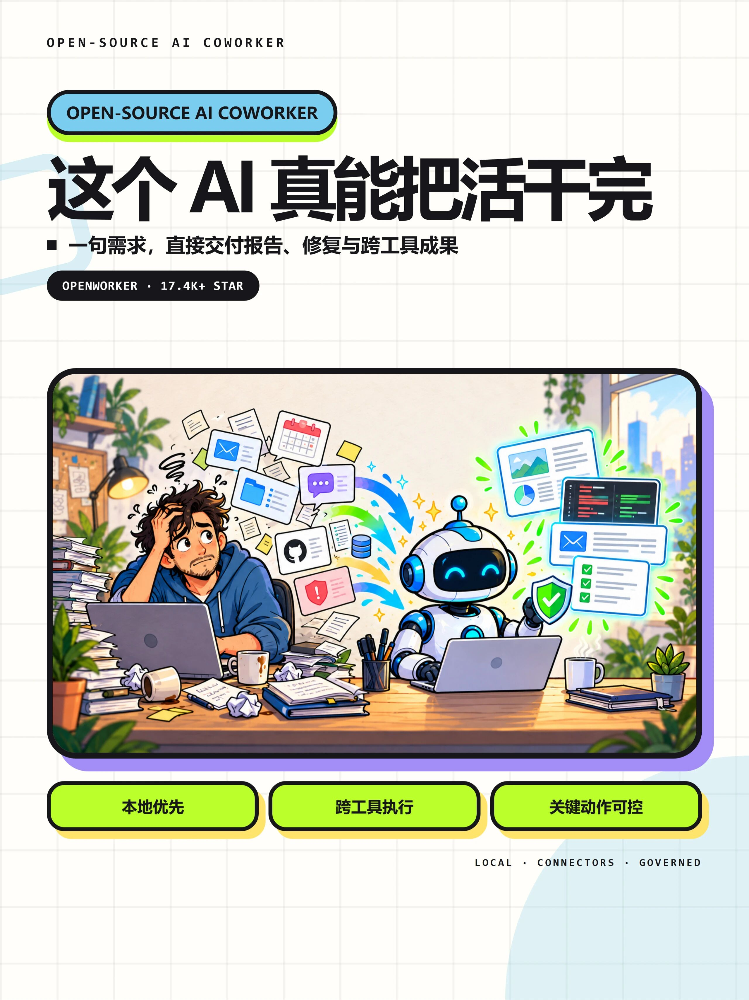

# 猴子 AI 笔记风格图文

把喜欢的视觉语言整理成可执行的设计参数、版式和参考图路由，制作中文 AI 项目封面、漫画信息图、流程卡片和软件截图图文。

## 视觉特点

暖白浅网格、超粗黑标题、荧光高亮、粗黑描边、彩色硬阴影，以及暖光漫画插画。默认使用 `editorial-bold`；截图图文和早期彩色拼贴使用各自独立 profile，不混成平均风格。

## 应用示例


这是一张实际生成的 1672×941 横版封面插画，展示该视觉语言在课件中的扩展应用；不是技能默认的 3:4 整页成品，也不是原作者的历史作品。

### 随包风格参考



上图为随包参考作品，用于观察版式和视觉约束，不冒称为本仓库生成结果或官方合作。素材说明见仓库根目录 [NOTICE](../NOTICE.md)。

## 使用

```text
使用 $monkey-ai-notes-imagegen，主题是“把零散资料变成可用知识”，
生成一张漫画封面和一张四步流程图，保持同一套视觉。
```

从 [SKILL.md](SKILL.md) 开始。技能包含设计参数、七类版式、参考图、提示词编译与基础图片诊断脚本。使用当前环境的原生图像生成能力，不需要把个人密钥写进技能文件。

## 工作方式

1. 明确主题、准确文案、张数和真实截图。
2. 选一个 profile 与对应的版式锚点，实际查看参考图。
3. 先做第一张样张，再扩展套图。
4. 检查文案、尺寸、颜色、描边与阴影，定向修正。

脚本：`scripts/build_prompt.py` 使用 Python 标准库；`scripts/inspect_image.py` 需要 Pillow 与 NumPy。

这里的 token 是 **设计参数**，不是认证 Token、原始提示词或模型内部参数。参考约束不保证每次生图逐像素一致。参考索引中的 `source-corpus/` 是去除个人本机路径后的来源标识；实际随包图片以 `asset` 字段为准。
